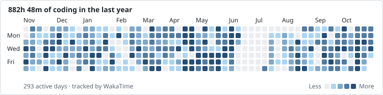

<div align="center">

<a href="https://iniisking.com">
  
</a>

<br/>

[](https://iniisking.com)
[](https://linkedin.com/in/inilonge)
[](https://x.com/iniisking)
[](https://instagram.com/iniisking)
[](mailto:inilonge@gmail.com)

</div>

---

### 🧑🏾‍💻 About me

```dart
final ini = Engineer(
  name: 'IniOluwa Longe',
  role: 'Mobile engineer',
  building: 'ChowTap: customer, rider & vendor apps',
  stack: ['Flutter', 'Dart', 'Swift', 'Node.js', 'Firebase', 'AWS'],
  loves: ['pixel-perfect UI', 'smooth animations', 'shipping'],
  askMeAbout: ['Flutter architecture', 'real-time apps', 'payments'],
);
```

### 🚀 Featured work

<table>
  <tr>
    <td width="50%" valign="top">
      <h4> <a href="https://chowtap.com">ChowTap</a></h4>
      Food delivery built for campus life. I build the three apps behind it:
      <b>customer</b>, <b>rider</b> and <b>vendor</b>, with live order
      tracking, wallets, chat and SLA timers.
      <br/><br/>
      
      
      
    </td>
    <td width="50%" valign="top">
      <h4>💳 <a href="https://github.com/iniisking/manycards-mobile">ManyCards</a></h4>
      Multi-currency wallet for NGN, USD and GBP: virtual cards, subcards,
      Paystack funding and currency conversion.
      <br/><br/>
      
      
    </td>
  </tr>
  <tr>
    <td width="50%" valign="top">
      <h4>🗣️ <a href="https://github.com/iniisking/sorosokay">Sorosokay</a></h4>
      Speech-first note taking, designed around the Yoruba language.
      Talk, and your notes write themselves.
      <br/><br/>
      
      
    </td>
    <td width="50%" valign="top">
      <h4>📺 <a href="https://github.com/iniisking/roku-ssdp">roku-ssdp</a></h4>
      Finds and controls Roku &amp; Google TV devices on your network with
      native Android SSDP/mDNS discovery.
      <br/><br/>
      
      
    </td>
  </tr>
</table>

<sub>More: <a href="https://github.com/iniisking/jollycast">Jollycast</a> (podcast streaming with offline playback) · <a href="https://github.com/iniisking/biometrics-dashboard">Biometrics Dashboard</a> (Flutter web) · <a href="https://github.com/iniisking/cloture">Cloture</a> (e-commerce)</sub>

### 🛠️ Tech I reach for

<p align="center">
  <b>Mobile</b><br/>
  
  <br/><br/>
  <b>Backend &amp; data</b><br/>
  
  <br/><br/>
  <b>Cloud &amp; tools</b><br/>
  
</p>

### ⏱️ A year in code

<picture>
  <source media="(prefers-color-scheme: dark)" srcset="./waka/heatmap-dark.svg" />
  
</picture>

<sub>This week, by language:</sub>

<!--START_SECTION:waka-->

```txt
From: 19 October 2026 - To: 26 October 2026

Total Time: 18 hrs 7 mins

Dart          12 hrs 43 mins        ██████████████░░░░░░░░░░░   55.93 %
Other         4 hrs 38 mins         █████░░░░░░░░░░░░░░░░░░░░   20.37 %
Swift         2 hrs 16 mins         ██▒░░░░░░░░░░░░░░░░░░░░░░   09.96 %
YAML          1 hr 6 mins           █▒░░░░░░░░░░░░░░░░░░░░░░░   04.84 %
JavaScript    34 mins               ▓░░░░░░░░░░░░░░░░░░░░░░░░   02.49 %
```

<!--END_SECTION:waka-->

### 🔥 Streak

<p align="center">
  
</p>

### 🐍 Eating my contributions

<picture>
  <source media="(prefers-color-scheme: dark)" srcset="https://raw.githubusercontent.com/iniisking/iniisking/output/snake-dark.svg" />
  
</picture>

<div align="center">

<br/>


</div>


